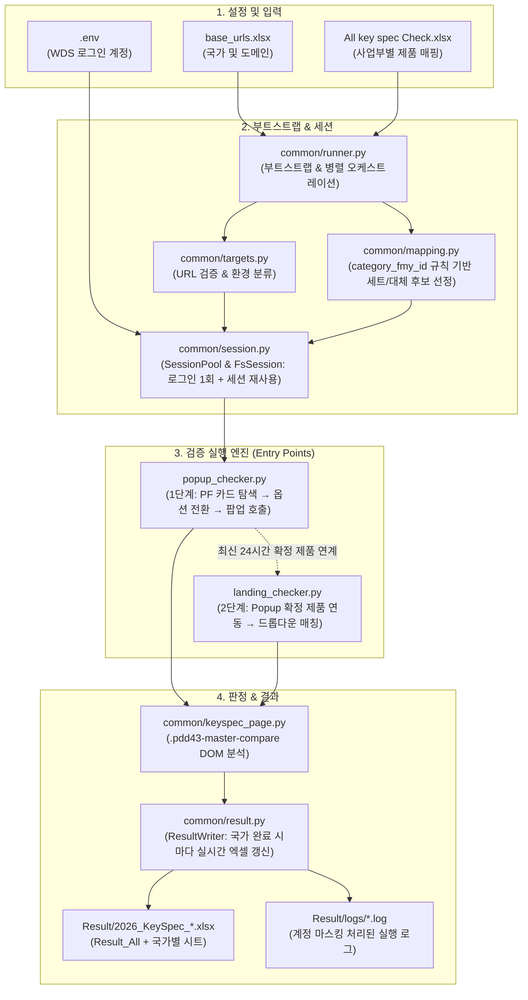

# Samsung New Compare Key Spec Checker (`Jake_compare_key_spec`)

삼성전자 웹사이트의 **Compare Landing Page**와 **PF(Product Finder) Popup Layer**에서 사업부(MX / VD / DA)별 제품 세트의 **Key Specs(주요 스펙)** 노출 및 데이터 일치 여부를 자동으로 검증하는 Playwright 기반 E2E 테스트 자동화 도구입니다.

---

## 📌 목차
1. [프로젝트 개요](#-프로젝트-개요)
2. [전체 시스템 아키텍처](#-전체-시스템-아키텍처)
3. [디렉토리 및 모듈 구조](#-디렉토리-및-모듈-구조)
4. [핵심 동작 메커니즘](#-핵심-동작-메커니즘)
   - [4.1 실행 대상 및 환경 식별](#41-실행-대상-및-환경-식별)
   - [4.2 제품 세트 선정 및 대체 로직](#42-제품-세트-선정-및-대체-로직)
   - [4.3 세션 관리 및 WDS 로그인 풀링](#43-세션-관리-및-wds-로그인-풀링)
   - [4.4 PF POPUP Checker 동작 흐름](#44-pf-popup-checker-동작-흐름)
   - [4.5 Landing Checker 동작 흐름](#45-landing-checker-동작-흐름)
   - [4.6 Key Specs 판정 규칙](#46-key-specs-판정-규칙)
   - [4.7 결과 리포트 및 Excel 생성](#47-결과-리포트-및-excel-생성)
5. [설치 및 환경 설정](#-설치-및-환경-설정)
6. [실행 방법 및 CLI 옵션](#-실행-방법-및-cli-옵션)
7. [주요 예외 처리 및 트러블슈팅](#-주요-예외-처리-및-트러블슈팅)

---

## 1. 프로젝트 개요

- **검증 대상**:
  - **Compare Landing Page** (`https://<host>/<site>/.../compare/`): 비교 모델 랜딩 페이지에서 드롭다운으로 제품 및 SKU(용량/사이즈/색상)를 설정하여 스펙 비교를 노출하는 화면.
  - **PF POPUP Layer** (`https://<host>/<site>/.../all-.../`): 제품 목록(Product Finder)에서 체크박스 선택 후 하단 플로팅 바의 Compare 버튼을 클릭하여 열리는 레이어 팝업.
- **대상 사업부**:
  - **MX** (Mobile eXperience)
  - **VD** (Visual Display)
  - **DA** (Digital Appliances)
- **지원 환경**:
  - **LIVE** (`www.samsung.com`): 별도 로그인 없이 즉시 접속하여 검증.
  - **P6_PRE_QA3** (`p6-pre-qa3.samsung.com`): Samsung WDS SSO 로그인을 통한 AEM 인증 세션 자동 획득 및 갱신.
- **핵심 목표**:
  - 매핑 테이블 기준 최신(Latest, Set 1) 및 중간(Middle, Set 2) 3개 제품을 일관되게 추출.
  - 화면 미노출 SKU 발생 시 결정론적 순서로 대체 제품 자동 치환.
  - Popup 검증 확정 제품을 Landing 검증과 상호 연동하여 동일 제품 세트 무결성 보장.

---

## 2. 전체 시스템 아키텍처



---

## 3. 디렉토리 및 모듈 구조

```text
Jake_compare_key_spec/
├─ landing_checker.py          # [Entry Point 1] Compare 랜딩 페이지 드롭다운 선택 및 Key Specs 검증
├─ popup_checker.py            # [Entry Point 2] PF 체크박스 선택, 옵션 전환, 팝업 오픈 및 Key Specs 검증
│
├─ common/                     # 공통 비즈니스 로직 모듈
│  ├─ config.py                # 타임아웃, 카테고리 매핑, 페이지 경로, 제품 선정 상수
│  ├─ targets.py               # base_urls.xlsx 로딩, 국가코드 파싱, Live/QA 도메인 검증
│  ├─ mapping.py               # All key spec Check.xlsx 로딩, category_fmy_id 규칙 세트 및 대체 후보 산출
│  ├─ session.py               # SessionPool, WDS 로그인, AEM 세션 만료 감지 및 Thread-Safe 재획득, 로그 마스킹
│  ├─ keyspec_page.py          # .pdd43-master-compare 컴포넌트 평가, 쿠키 배너 처리, Key Specs 채움 판정
│  ├─ result.py                # SKU 매칭 검증, 단일 ResultWriter(실시간 덮어쓰기), 셀 색상 스타일링
│  ├─ runner.py                # CLI 인자 처리, 국가/사업부 병렬 실행 오케스트레이터, 예외 격리
│  └─ __init__.py
│
├─ login/                      # 인증 모듈
│  ├─ WDS_login_FS_Auto.py     # Samsung WDS SSO 자동 로그인 및 goLink 클릭 스크립트
│  ├─ .env                     # LOGIN_ID_Auto, LOGIN_PW_Auto (계정 정보, 절대 커밋 금지)
│  └─ .env.example             # 환경변수 템플릿
│
├─ Docs/                       # 기준 문서 및 분석 자료
│  ├─ All key spec Check.xlsx  # 기준 매핑 데이터 (MX, VD, DA 시트)
│  └─ Defect_DE_Freezer_...md  # 결함 분석 초안 리포트
│
├─ URL/
│  └─ base_urls.xlsx           # 실행 대상 URL 목록 (첫 시트 base_url 컬럼)
│
├─ Result/                     # 실행 결과 파일 저장소
│  ├─ logs/                    # 타임스탬프 기반 텍스트 로그 파일
│  └─ 2026_KeySpec_*.xlsx      # 최종 엑셀 리포트 (실행 시각별 자동 생성)
│
└─ Scratch/                    # 디버깅 및 가상 시뮬레이션 스크립트
   ├─ debug_bootstrap.py       # 환경/매핑 로딩 검증 스크립트 (실제 로그인 없음)
   └─ sim_parallel_run.py      # 가상 네트워크 요청을 통한 병렬/세션 갱신 시뮬레이터
```

---

## 4. 핵심 동작 메커니즘

### 4.1 실행 대상 및 환경 식별 (`common/targets.py`)
- `URL/base_urls.xlsx`의 첫 번째 시트 `base_url` 컬럼에서 URL 목록을 읽어옵니다.
- **환경 판별 (`detect_env`)**:
  - `www.samsung.com` 호스트 $\rightarrow$ `LIVE` (로그인 생략)
  - `p6-pre-qa3` 문자열 포함 호스트 $\rightarrow$ `P6_PRE_QA3` (WDS 로그인 필요)
- **국가 식별 (`extract_site_code`)**: URL 경로의 첫 번째 세그먼트 정규식 매칭 (`uk`, `de`, `ae_ar`, `latin` 등).
- **엄격한 데이터 검증**: 빈 URL, 잘못된 URL 형식, 미지원 호스트, 동일 환경 내 중복 국가가 1건이라도 발견되면 임의 기본값을 쓰지 않고 `TargetError`를 발생시켜 즉시 중단합니다.

### 4.2 제품 세트 선정 및 대체 로직 (`common/mapping.py`)
매핑 파일(`Docs/All key spec Check.xlsx`)의 `SITE_CD` 일치 및 `DISPLAY_STATUS == 'Y'` 제품 중 유효한 `REP_MODEL`과 숫자형 `FMY_ID`를 가진 제품을 대상으로 합니다.

- **규칙 (`PRODUCT_SET_RULE = "category_fmy_id"`)**:
  | 사업부 | Set 1 (Latest) 카테고리 | Set 2 (Middle) 카테고리 | IA_CD Prefix |
  | :--- | :--- | :--- | :--- |
  | **MX** | Smartphones | Tablets | 0101 / 0102 |
  | **VD** | TVs | TVs | 0401 |
  | **DA** | Refrigerators | Washers & Dryers (Laundry) | 0803 / 0801 |

- **선정 알고리즘**:
  1. 각 지정 카테고리 내에서 `FMY_ID` 오름차순 정렬.
  2. **Latest (Set 1)**: `FMY_ID`가 가장 큰 최상위 3개 제품.
     - **대체 후보군**: 그 다음으로 `FMY_ID`가 큰 제품부터 내림차순 정렬.
  3. **Middle (Set 2)**:
     - Latest와 카테고리가 다른 경우(MX, DA): 해당 카테고리 전체의 중앙값(Center) 3개 제품 선정.
     - Latest와 카테고리가 같은 경우(VD): Latest 3개를 제외한 나머지 제품들의 중앙값 3개 제품 선정.
     - **대체 후보군**: 중앙 인덱스로부터 거리가 가까운 순서(`_by_distance`)로 정렬.
  4. **화면 미노출 시 대체 (`substitution_plan`)**: 화면(PF 카드 또는 드롭다운)에 제품이 없거나 SKU가 맞지 않는 경우, 정의된 대체 후보 풀에서 최대 10개(`MAX_ALTERNATES`)까지 순차 시도합니다. 같은 사업부의 다른 Set에 이미 사용된 제품은 중복 선택되지 않습니다.

### 4.3 세션 관리 및 WDS 로그인 풀링 (`common/session.py`)
- **SessionPool (단일 브라우저 + 환경별 세션 재사용)**:
  - 브라우저는 전체 실행 동안 1개만 실행합니다.
  - `p6-pre-qa3` 일반 국가는 동일한 WDS 로그인 쿠키를 공유하여 1회만 로그인하고 모든 국가가 세션을 재사용합니다 (중국 `cn`은 `p6-preqa3-cn` goLink를 사용하므로 별도 1회 로그인).
  - 각 국가 및 사업부 워커는 쿠키(`storage_state`)만 복사한 격리된 `BrowserContext`(`worker_context`)를 생성하여 화면 상태 간섭을 방지합니다.
- **WMC 공지 팝업 자동 해제 (`dismiss_wmc_notices`)**:
  - 로그인 직후 WDS 화면에 표시되어 goLink 클릭을 가로막는 공지 레이어(`.wmcNotice`)의 'close' 버튼(`[name="close"]`)을 클릭하고, 잔여 공지 및 반투명 딤(dim) 오버레이를 `display: none !important`로 강제 숨김 처리합니다.
- **스레드 세이프 세션 재획득 (`recover`)**:
  - QA 세션 만료로 AEM 로그인 페이지가 감지되면, `asyncio.Lock`과 `generation`(세대 번호)을 사용하여 여러 워커가 동시에 만료를 인지하더라도 WDS `goLink` 재클릭 및 재로그인을 **단 1회만 수행**합니다.
- **보안 및 마스킹**:
  - `setup_logging`을 통해 콘솔 및 로그 파일 출력 시 `.env`의 `LOGIN_ID_Auto`, `LOGIN_PW_Auto` 등 민감 정보를 `***`로 자동 마스킹합니다.

### 4.4 PF POPUP Checker 동작 흐름 (`popup_checker.py`)
1. **PF 페이지 진입**: 카테고리별 PF URL(`.../all-.../`)로 이동.
2. **비교 가능 여부 사전 진단 (`wait_checkboxes`)**: 카드의 비교 영역이 `pd21-product-card__compare--no-data`인 경우 해당 사이트 미제공으로 즉시 처리 (불필요한 60초 대기 방지).
3. **카드 무한 스크롤 탐색 (`load_until_found`)**: 화면에 필요한 SKU 체크박스가 모두 보일 때까지 하단 'View more'(`.pd21-product-finder__view-more`)를 클릭하며 점진적 로딩.
4. **2단계 카드 옵션 자동 전환 (`switch_to_codes`)**:
   - 카드가 렌더링되어 있으나 기본 옵션이 다른 SKU인 경우:
     - **1단계**: 카드의 옵션 버튼(`optionButtons`) 속성에 목표 SKU가 직접 포함되어 있으면 해당 버튼 클릭.
     - **2단계**: 복합 옵션(색상+용량) 제품은 모델 기본형(`data-modelname`)을 찾아 색상 버튼을 순차 클릭한 후 생성되는 SKU 옵션 버튼 클릭.
5. **체크박스 선택 및 레이어 오픈**: 목표 3개 제품의 체크박스(`.js-pfv2-compare-cta`) 선택 $\rightarrow$ 하단 플로팅 바의 Compare 버튼(`.js-pfv2-open-compare-layer`) 클릭.
6. **API 응답 및 렌더링 동기화**: `master/compare` XHR/Fetch API 응답을 가로채 확인하고, Key Specs 섹션(`.pdd43-master-compare__feature`)이 채워질 때까지 동기화 대기 후 검증 수행.

### 4.5 Landing Checker 동작 흐름 (`landing_checker.py`)
1. **Popup 확정 제품 자동 연동 (`USE_POPUP_PRODUCTS = True`)**:
   - `Result/` 디렉터리에서 최근 24시간 이내에 생성된 가장 최신 Popup 결과 엑셀(`2026_KeySpec_Popup_*.xlsx`)을 파싱.
   - Popup에서 최종 확인된(SKU 매칭 PASS) 3개 제품을 Landing 검증 대상으로 자동 주입하여 **Popup과 Landing 간 검증 대상 일치성**을 확보.
2. **랜딩 페이지 진입**: 카테고리별 Compare 페이지(`.../compare/`)로 이동하여 `.pdd43-master-compare` 루트 및 카드 렌더링 확인.
3. **드롭다운 선택 (`select_product`, 2026-11-10 재설계)**:
   - 각 열(1, 2, 3열)의 카드 드롭다운 분석 (`split_dropdowns`: 제품 드롭다운과 옵션 드롭다운 분리, 숨은 복제 목록 제외).
   - 옵션 순서: ① 옵션 속성값에 SKU ② 이 페이지에서 이미 SKU를 확인한 옵션 ③ **Popup 결과의 화면 표시명(현지어)과 같은 글자** ④ 이름 유사도 ⑤ 남은 옵션을 직접 골라 열 SKU 확인(`LANDING_SCAN_MAX`개까지).
   - 클릭은 순번이 아니라 **드롭다운을 연 뒤 보이는 옵션을 글자로 그 자리에서 찾아** 누름(목록 재정렬·복제 목록 대응). 이미 선택된 옵션은 누르지 않음.
   - 성공 기준은 오직 **열 SKU == 매핑 SKU**. 열·Set마다 시간 한도(`LANDING_SELECT_BUDGET_S`, `LANDING_SET_BUDGET_S`).
   - 못 띄운 열은 대체 후보로 같은 열에 다시 시도하고, 끝까지 못 띄우면 그 열만 `확인 필요`(SKU 매칭도 `확인 필요` — 사이트 SKU 불일치 FAIL과 구분).
4. **Key spec 대체 (`common/substitute.py`, Popup·Landing 공통)**: 요청 제품에 Key Specs가 없으면(열 값 없음 / 섹션 미노출 / 새 팝업 미표시) 같은 사업부·같은 카테고리의 다른 매핑 제품으로 바꿔 다시 확인합니다.
   - 열 값이 없으면 그 제품만 교체, 섹션 전체 미노출·팝업 미표시처럼 원인 제품을 모르면 **한 번에 한 제품씩** 바꿔 보며 원인을 찾습니다(해결되면 원래 제품이 원인으로 확인).
   - 후보로도 해결되지 않으면 **원래 제품으로 되돌려** 다시 확인한 결과를 기록합니다(원래 제품이 결과에서 사라지지 않음).
   - 판정 규칙은 그대로이며, 바뀐 제품은 비고 앞에 `[Key spec 대체] 원래 제품 … 사유 → 이 제품으로 대체`로 남고 로그에 `[KEYSPEC-대체]` 줄이 남습니다(결함 후보 추적용).
   - 설정: `KEYSPEC_SUBSTITUTE_ROUNDS`(기본 6, 0이면 대체 안 함), `POPUP_SET_BUDGET_S` / `LANDING_SET_BUDGET_S`.

### 4.6 Key Specs 판정 규칙 (`common/keyspec_page.py`)
`.pdd43-master-compare` 내부의 `.pdd43-master-compare__feature` 섹션 가시성 및 각 열(`feature-item--N`)의 값 유무를 검사합니다:

| 검증 시나리오 | Landing Checker 판정 | Popup Checker 판정 | 설명 및 근거 |
| :--- | :---: | :---: | :--- |
| **섹션 노출 + 해당 열 값 있음** | **PASS** | **PASS** | 스펙 라벨 및 데이터가 정상 표시됨 |
| **섹션 노출 + 해당 열 값 없음 (`-` 또는 공백)** | **FAIL** | **FAIL** | 스펙 항목 데이터 누락 |
| **Key Specs 섹션 자체가 미노출** | **FAIL** | **확인 필요** | **Popup 규칙**: 세트 3개 중 1개라도 스펙 데이터가 없는 제품이 섞이면 레이어 전체 섹션이 숨겨지므로 개별 제품 실패로 단정하지 않고 확인 필요로 분류 |
| **새 Compare 팝업 미오픈 / 레거시 팝업 오픈** | N/A | **확인 필요** | 신규 Compare 컴포넌트 미배포 상태 |
| **새 Compare 영역 없는 Landing 페이지** | **확인 필요** | N/A | 신규 랜딩 컴포넌트 미배포 상태 |
| **제품 미선택 / 화면 열 SKU 불일치** | **확인 필요** | **확인 필요** | 엉뚱한 제품 스펙이 판정되는 것을 방지 |

### 4.7 결과 리포트 및 Excel 생성 (`common/result.py`)
- **단일 Writer 실시간 저장**:
  - `ResultWriter`는 각 국가 검증이 끝날 때마다 전체 스냅샷을 엑셀 파일에 다시 저장하므로, 작업이 중단되어도 직전 국가까지의 결과가 온전히 보존됩니다.
  - 파일 열림 에러(`PermissionError`) 발생 시 타임스탬프를 덧붙여 새 파일로 우회 저장합니다.
- **파일명 형식**:
  - `Result/2026_KeySpec_Landing_YYYYMMDD_HHMMSS.xlsx`
  - `Result/2026_KeySpec_Popup_YYYYMMDD_HHMMSS.xlsx`
- **시트 구조**:
  - `Result_All`: 전체 국가 합본 시트.
  - `<SITE_CD>`: 국가별 개별 시트 (예: `UK`, `DE`, `AE_AR`).
- **컬럼 구성 및 서식**:
  | 컬럼명 | 내용 |
  | :--- | :--- |
  | **국가** | 사이트코드 대문자 (예: `UK`, `DE`) |
  | **사업부** | `MX`, `VD`, `DA` |
  | **Set** | `Set 1`, `Set 2` |
  | **구분** | `Latest`, `Middle` |
  | **mapping table 텍스트** | 매핑 파일의 `FMY_MKT_NM` |
  | **최종 페이지 랜딩 후 제품 텍스트** | Compare 화면 카드에 실제 노출된 제품명 |
  | **SKU** | 매핑 기준 `REP_MODEL` |
  | **최종 페이지 SKU** | Compare 화면 카드에 실제 노출된 SKU |
  | **SKU 매칭 결과** | SKU 일치 시 `PASS`, 불일치 시 `FAIL`, 미도달 시 `확인 필요` |
  | **HTTP 상태** | 메인 문서 이동 HTTP 상태 코드 (200이 아니면 빨간색 강조) |
  | **Key spec 존재 결과** | `PASS`, `FAIL`, `확인 필요` |
  | **비고** | 대체 이력(`[대체]`), 세부 시도 내역, 대상 URL, 에러 원인 상세 |
- **색상 스타일**:
  - `PASS`: 초록색 배경 (`#C6EFCE`)
  - `FAIL`: 빨간색 배경 (`#FFC7CE`), 진한 빨간색 글자 (`#9C0006`)
  - `확인 필요`: 노란색 배경 (`#FFD966`)

---

## 5. 설치 및 환경 설정

### 5.1 필수 라이브러리 설치
## 4. 핵심 동작 메커니즘

### 4.1 실행 대상 및 환경 식별 (`common/targets.py`)
- `URL/base_urls.xlsx`의 첫 번째 시트 `base_url` 컬럼에서 URL 목록을 읽어옵니다.
- **환경 판별 (`detect_env`)**:
  - `www.samsung.com` 호스트 $\rightarrow$ `LIVE` (로그인 생략)
  - `p6-pre-qa3` 문자열 포함 호스트 $\rightarrow$ `P6_PRE_QA3` (WDS 로그인 필요)
- **국가 식별 (`extract_site_code`)**: URL 경로의 첫 번째 세그먼트 정규식 매칭 (`uk`, `de`, `ae_ar`, `latin` 등).
- **엄격한 데이터 검증**: 빈 URL, 잘못된 URL 형식, 미지원 호스트, 동일 환경 내 중복 국가가 1건이라도 발견되면 임의 기본값을 쓰지 않고 `TargetError`를 발생시켜 즉시 중단합니다.

### 4.2 제품 세트 선정 및 대체 로직 (`common/mapping.py`)
매핑 파일(`Docs/All key spec Check.xlsx`)의 `SITE_CD` 일치 및 `DISPLAY_STATUS == 'Y'` 제품 중 유효한 `REP_MODEL`과 숫자형 `FMY_ID`를 가진 제품을 대상으로 합니다.

- **규칙 (`PRODUCT_SET_RULE = "category_fmy_id"`)**:
  | 사업부 | Set 1 (Latest) 카테고리 | Set 2 (Middle) 카테고리 | IA_CD Prefix |
  | :--- | :--- | :--- | :--- |
  | **MX** | Smartphones | Tablets | 0101 / 0102 |
  | **VD** | TVs | TVs | 0401 |
  | **DA** | Refrigerators | Washers & Dryers (Laundry) | 0803 / 0801 |

- **선정 알고리즘**:
  1. 각 지정 카테고리 내에서 `FMY_ID` 오름차순 정렬.
  2. **Latest (Set 1)**: `FMY_ID`가 가장 큰 최상위 3개 제품.
     - **대체 후보군**: 그 다음으로 `FMY_ID`가 큰 제품부터 내림차순 정렬.
  3. **Middle (Set 2)**:
     - Latest와 카테고리가 다른 경우(MX, DA): 해당 카테고리 전체의 중앙값(Center) 3개 제품 선정.
     - Latest와 카테고리가 같은 경우(VD): Latest 3개를 제외한 나머지 제품들의 중앙값 3개 제품 선정.
     - **대체 후보군**: 중앙 인덱스로부터 거리가 가까운 순서(`_by_distance`)로 정렬.
  4. **화면 미노출 시 대체 (`substitution_plan`)**: 화면(PF 카드 또는 드롭다운)에 제품이 없거나 SKU가 맞지 않는 경우, 정의된 대체 후보 풀에서 최대 10개(`MAX_ALTERNATES`)까지 순차 시도합니다. 같은 사업부의 다른 Set에 이미 사용된 제품은 중복 선택되지 않습니다.

### 4.3 세션 관리 및 WDS 로그인 풀링 (`common/session.py`)
- **SessionPool (단일 브라우저 + 환경별 세션 재사용)**:
  - 브라우저는 전체 실행 동안 1개만 실행합니다.
  - `p6-pre-qa3` 일반 국가는 동일한 WDS 로그인 쿠키를 공유하여 1회만 로그인하고 모든 국가가 세션을 재사용합니다 (중국 `cn`은 `p6-preqa3-cn` goLink를 사용하므로 별도 1회 로그인).
  - 각 국가 및 사업부 워커는 쿠키(`storage_state`)만 복사한 격리된 `BrowserContext`(`worker_context`)를 생성하여 화면 상태 간섭을 방지합니다.
- **WMC 공지 팝업 자동 해제 (`dismiss_wmc_notices`)**:
  - 로그인 직후 WDS 화면에 표시되어 goLink 클릭을 가로막는 공지 레이어(`.wmcNotice`)의 'close' 버튼(`[name="close"]`)을 클릭하고, 잔여 공지 및 반투명 딤(dim) 오버레이를 `display: none !important`로 강제 숨김 처리합니다.
- **스레드 세이프 세션 재획득 (`recover`)**:
  - QA 세션 만료로 AEM 로그인 페이지가 감지되면, `asyncio.Lock`과 `generation`(세대 번호)을 사용하여 여러 워커가 동시에 만료를 인지하더라도 WDS `goLink` 재클릭 및 재로그인을 **단 1회만 수행**합니다.
- **보안 및 마스킹**:
  - `setup_logging`을 통해 콘솔 및 로그 파일 출력 시 `.env`의 `LOGIN_ID_Auto`, `LOGIN_PW_Auto` 등 민감 정보를 `***`로 자동 마스킹합니다.

### 4.4 PF POPUP Checker 동작 흐름 (`popup_checker.py`)
1. **PF 페이지 진입**: 카테고리별 PF URL(`.../all-.../`)로 이동.
2. **비교 가능 여부 사전 진단 (`wait_checkboxes`)**: 카드의 비교 영역이 `pd21-product-card__compare--no-data`인 경우 해당 사이트 미제공으로 즉시 처리 (불필요한 60초 대기 방지).
3. **카드 무한 스크롤 탐색 (`load_until_found`)**: 화면에 필요한 SKU 체크박스가 모두 보일 때까지 하단 'View more'(`.pd21-product-finder__view-more`)를 클릭하며 점진적 로딩.
4. **2단계 카드 옵션 자동 전환 (`switch_to_codes`)**:
   - 카드가 렌더링되어 있으나 기본 옵션이 다른 SKU인 경우:
     - **1단계**: 카드의 옵션 버튼(`optionButtons`) 속성에 목표 SKU가 직접 포함되어 있으면 해당 버튼 클릭.
     - **2단계**: 복합 옵션(색상+용량) 제품은 모델 기본형(`data-modelname`)을 찾아 색상 버튼을 순차 클릭한 후 생성되는 SKU 옵션 버튼 클릭.
5. **체크박스 선택 및 레이어 오픈**: 목표 3개 제품의 체크박스(`.js-pfv2-compare-cta`) 선택 $\rightarrow$ 하단 플로팅 바의 Compare 버튼(`.js-pfv2-open-compare-layer`) 클릭.
6. **API 응답 및 렌더링 동기화**: `master/compare` XHR/Fetch API 응답을 가로채 확인하고, Key Specs 섹션(`.pdd43-master-compare__feature`)이 채워질 때까지 동기화 대기 후 검증 수행.

### 4.5 Landing Checker 동작 흐름 (`landing_checker.py`)
1. **Popup 확정 제품 자동 연동 (`USE_POPUP_PRODUCTS = True`)**:
   - `Result/` 디렉터리에서 최근 24시간 이내에 생성된 가장 최신 Popup 결과 엑셀(`2026_KeySpec_Popup_*.xlsx`)을 파싱.
   - Popup에서 최종 확인된(SKU 매칭 PASS) 3개 제품을 Landing 검증 대상으로 자동 주입하여 **Popup과 Landing 간 검증 대상 일치성**을 확보.
2. **랜딩 페이지 진입**: 카테고리별 Compare 페이지(`.../compare/`)로 이동하여 `.pdd43-master-compare` 루트 및 카드 렌더링 확인.
3. **지능형 드롭다운 매칭 (`select_product`)**:
   - 각 열(1, 2, 3열)의 카드 드롭다운 분석 (`split_dropdowns`: 제품 드롭다운과 옵션 드롭다운 분리).
   - 제품명 가중 F1 토큰 유사도(`option_score`)를 계산하여 가장 일치도가 높은 제품 옵션 선택.
   - 단일 제품의 용량/크기/색상 옵션 드롭다운을 탐색하여 화면의 열 SKU(`.pdd43-master-compare__sku-text`)가 매핑 SKU와 일치할 때까지 전환.
   - 일치하지 않을 경우 매핑의 대체 후보 풀을 순차 적용하여 재시도.

### 4.6 Key Specs 판정 규칙 (`common/keyspec_page.py`)
`.pdd43-master-compare` 내부의 `.pdd43-master-compare__feature` 섹션 가시성 및 각 열(`feature-item--N`)의 값 유무를 검사합니다:

| 검증 시나리오 | Landing Checker 판정 | Popup Checker 판정 | 설명 및 근거 |
| :--- | :---: | :---: | :--- |
| **섹션 노출 + 해당 열 값 있음** | **PASS** | **PASS** | 스펙 라벨 및 데이터가 정상 표시됨 |
| **섹션 노출 + 해당 열 값 없음 (`-` 또는 공백)** | **FAIL** | **FAIL** | 스펙 항목 데이터 누락 |
| **Key Specs 섹션 자체가 미노출** | **FAIL** | **확인 필요** | **Popup 규칙**: 세트 3개 중 1개라도 스펙 데이터가 없는 제품이 섞이면 레이어 전체 섹션이 숨겨지므로 개별 제품 실패로 단정하지 않고 확인 필요로 분류 |
| **새 Compare 팝업 미오픈 / 레거시 팝업 오픈** | N/A | **확인 필요** | 신규 Compare 컴포넌트 미배포 상태 |
| **새 Compare 영역 없는 Landing 페이지** | **확인 필요** | N/A | 신규 랜딩 컴포넌트 미배포 상태 |
| **제품 미선택 / 화면 열 SKU 불일치** | **확인 필요** | **확인 필요** | 엉뚱한 제품 스펙이 판정되는 것을 방지 |

### 4.7 결과 리포트 및 Excel 생성 (`common/result.py`)
- **단일 Writer 실시간 저장**:
  - `ResultWriter`는 각 국가 검증이 끝날 때마다 전체 스냅샷을 엑셀 파일에 다시 저장하므로, 작업이 중단되어도 직전 국가까지의 결과가 온전히 보존됩니다.
  - 파일 열림 에러(`PermissionError`) 발생 시 타임스탬프를 덧붙여 새 파일로 우회 저장합니다.
- **파일명 형식**:
  - `Result/2026_KeySpec_Landing_YYYYMMDD_HHMMSS.xlsx`
  - `Result/2026_KeySpec_Popup_YYYYMMDD_HHMMSS.xlsx`
- **시트 구조**:
  - `Result_All`: 전체 국가 합본 시트.
  - `<SITE_CD>`: 국가별 개별 시트 (예: `UK`, `DE`, `AE_AR`).
- **컬럼 구성 및 서식**:
  | 컬럼명 | 내용 |
  | :--- | :--- |
  | **국가** | 사이트코드 대문자 (예: `UK`, `DE`) |
  | **사업부** | `MX`, `VD`, `DA` |
  | **Set** | `Set 1`, `Set 2` |
  | **구분** | `Latest`, `Middle` |
  | **mapping table 텍스트** | 매핑 파일의 `FMY_MKT_NM` |
  | **최종 페이지 랜딩 후 제품 텍스트** | Compare 화면 카드에 실제 노출된 제품명 |
  | **SKU** | 매핑 기준 `REP_MODEL` |
  | **최종 페이지 SKU** | Compare 화면 카드에 실제 노출된 SKU |
  | **SKU 매칭 결과** | SKU 일치 시 `PASS`, 불일치 시 `FAIL`, 미도달 시 `확인 필요` |
  | **HTTP 상태** | 메인 문서 이동 HTTP 상태 코드 (200이 아니면 빨간색 강조) |
  | **Key spec 존재 결과** | `PASS`, `FAIL`, `확인 필요` |
  | **비고** | 대체 이력(`[대체]`), 세부 시도 내역, 대상 URL, 에러 원인 상세 |
- **색상 스타일**:
  - `PASS`: 초록색 배경 (`#C6EFCE`)
  - `FAIL`: 빨간색 배경 (`#FFC7CE`), 진한 빨간색 글자 (`#9C0006`)
  - `확인 필요`: 노란색 배경 (`#FFD966`)

---

## 5. 설치 및 환경 설정

### 5.1 필수 라이브러리 설치
```powershell
pip install openpyxl playwright python-dotenv
playwright install chromium
```

### 5.2 계정 정보 설정 (`login/.env`)
`login/.env` 파일을 생성하고 WDS 자동 로그인에 사용할 계정을 입력합니다:
```env
LOGIN_ID_Auto=your_wds_id
LOGIN_PW_Auto=your_wds_password
```
> [!CAUTION]
> `.env` 파일은 실제 계정 비밀번호를 포함하므로 절대 Git 저장소에 커밋하거나 공유하지 마십시오 (`.gitignore`에 등록됨).

### 5.3 대상 국가 및 URL 설정 (`URL/base_urls.xlsx`)
첫 번째 시트에 `base_url` 헤더를 두고 검증할 대상 URL을 작성합니다:
| base_url |
| :--- |
| `https://www.samsung.com/uk/` |
| `https://p6-pre-qa3.samsung.com/de/` |
| `https://p6-pre-qa3.samsung.com/ae_ar/` |

---

## 6. 실행 방법 및 CLI 옵션

### 6.1 권장 실행 순서
> [!TIP]
> **권장 실행 순서: Popup 실행 $\rightarrow$ Landing 실행**  
> `popup_checker.py`를 먼저 실행하여 실제 판매/전시 중인 카드를 바탕으로 최적의 SKU를 확정하면, `landing_checker.py`가 그 결과 엑셀을 읽어 동일한 3개 제품을 검증합니다.

```powershell
# 1단계: PF Popup Checker 실행
python popup_checker.py

# 2단계: Compare Landing Checker 실행 (Popup 결과 자동 연동)
python landing_checker.py
```

### 6.2 CLI 옵션

```powershell
# 사전 설정 및 대상 제품 세트 점검 (브라우저 실행 및 로그인 없음)
python popup_checker.py --dry-run
python landing_checker.py --dry-run

# 동시 처리 국가 수 변경 (기본값: 3)
python popup_checker.py --parallel 5

# 국가 처리 실패 시 재시도 횟수 지정 (기본값: 2)
python popup_checker.py --retries 3

# 화면 표시 모드로 실행하려면 common/config.py의 HEADED = True로 변경
```

### 6.3 디버그 및 검증 스크립트 (`Scratch/`)
```powershell
# 공통 환경 및 매핑 규칙, URL 유효성 검사 (실제 로그인 없음)
python Scratch/debug_bootstrap.py

# 가상 네트워크 요청을 통한 병렬 실행 및 세션 만료 복구 시뮬레이션
python Scratch/sim_parallel_run.py 12 slow

# 가짜 PF / Landing 페이지로 Popup·Landing 흐름 검증 (15개 시나리오: Key spec 대체, 현지어 드롭다운,
# 페이지 자동 재이동, 숨은 팝업 루트, Compare 미제공 PF, 끝까지 해결 안 되는 경우 등)
python Scratch/fake_site_test.py
```
실패한 Set은 화면 캡처가 `Result/logs/<로그 이름>_diag/`에 저장되고 비고에 파일 이름이 남습니다 (실행당 최대 `DIAG_SCREENSHOTS`장).

---

## 7. 주요 예외 처리 및 트러블슈팅

| 현상 / 이슈 | 원인 및 시스템 대응 |
| :--- | :--- |
| **`TargetError` 발생하며 즉시 중단** | `base_urls.xlsx`에 빈 행, 잘못된 프로토콜, 미지원 도메인, 중복 국가가 포함되어 있습니다. URL 목록을 정리하십시오. |
| **WMC 공지 팝업으로 인한 클릭 가림** | `session.py`의 `dismiss_wmc_notices`가 로그인 직후 공지 닫기 버튼을 클릭하고 잔여 레이어를 화면에서 즉시 숨깁니다. |
| **QA 세션 만료 (`AEM 로그인 화면 이동`)** | `CountrySession.goto`가 AEM 로그인을 감지하면 `Lock` 하에서 단 1회 WDS goLink 재클릭 또는 재로그인을 수행하여 복구합니다. |
| **PF 카드에 목표 SKU가 없는 경우** | `switch_to_codes`가 카드의 다른 색상/용량 버튼을 자동 클릭하여 체크박스를 활성화하며, 화면에 아예 없는 제품은 `substitution_plan`에 의해 다음 우선순위 대체 제품으로 자동 교체됩니다. |
| **PF에 Compare 기능이 없는 카테고리 (예: 특정 국가 TV)** | 카드가 `pd21-product-card__compare--no-data` 클래스를 가진 경우, 불필요한 타임아웃 대기 없이 즉시 사이트 미제공으로 기록합니다. |
| **실행 도중 Excel 파일 열람으로 인한 저장 오류** | `ResultWriter`가 `PermissionError`를 감지하여 파일명 뒤에 타임스탬프를 덧붙여 새 파일로 안전하게 우회 저장합니다. |
| **`Execution context was destroyed` (페이지가 로드 직후 스스로 다시 이동)** | 모든 페이지 스크립트 호출을 `ev()`/`wf()`로 감싸 로드를 기다린 뒤 다시 실행합니다. 그래도 Set 처리 중 예외가 나면 그 Set만 새 Context로 다시 시도(`SET_ATTEMPTS`)하고, 다른 Set·사업부 결과는 유지합니다. |
| **같은 p6 origin의 Compare 선택 상태가 다음 Set으로 넘어감** | Set마다 새 Context를 만들어 쿠키(로그인 세션)만 복사합니다. |
| **신규 Compare 컴포넌트 미배포 페이지** | `.pdd43-master-compare` 요소가 없는 레거시 페이지는 무리하게 스펙을 판정하지 않고 비고에 DOM 진단 결과(`JS_DIAG`)를 첨부하여 `확인 필요`로 기록합니다. |

```powershell
# 사전 설정 및 대상 제품 세트 점검 (브라우저 실행 및 로그인 없음)
python popup_checker.py --dry-run
python landing_checker.py --dry-run

# 동시 처리 국가 수 변경 (기본값: 3)
python popup_checker.py --parallel 5

# 국가 처리 실패 시 재시도 횟수 지정 (기본값: 2)
python popup_checker.py --retries 3

# 화면 표시 모드로 실행하려면 common/config.py의 HEADED = True로 변경
```

### 6.3 디버그 및 검증 스크립트 (`Scratch/`)
```powershell
# 공통 환경 및 매핑 규칙, URL 유효성 검사 (실제 로그인 없음)
python Scratch/debug_bootstrap.py

# 가상 네트워크 요청을 통한 병렬 실행 및 세션 만료 복구 시뮬레이션
python Scratch/sim_parallel_run.py 12 slow
```

---

## 7. 주요 예외 처리 및 트러블슈팅

| 현상 / 이슈 | 원인 및 시스템 대응 |
| :--- | :--- |
| **`TargetError` 발생하며 즉시 중단** | `base_urls.xlsx`에 빈 행, 잘못된 프로토콜, 미지원 도메인, 중복 국가가 포함되어 있습니다. URL 목록을 정리하십시오. |
| **WMC 공지 팝업으로 인한 클릭 가림** | `session.py`의 `dismiss_wmc_notices`가 로그인 직후 공지 닫기 버튼을 클릭하고 잔여 레이어를 화면에서 즉시 숨깁니다. |
| **QA 세션 만료 (`AEM 로그인 화면 이동`)** | `CountrySession.goto`가 AEM 로그인을 감지하면 `Lock` 하에서 단 1회 WDS goLink 재클릭 또는 재로그인을 수행하여 복구합니다. |
| **PF 카드에 목표 SKU가 없는 경우** | `switch_to_codes`가 카드의 다른 색상/용량 버튼을 자동 클릭하여 체크박스를 활성화하며, 화면에 아예 없는 제품은 `substitution_plan`에 의해 다음 우선순위 대체 제품으로 자동 교체됩니다. |
| **PF에 Compare 기능이 없는 카테고리 (예: 특정 국가 TV)** | 카드가 `pd21-product-card__compare--no-data` 클래스를 가진 경우, 불필요한 타임아웃 대기 없이 즉시 사이트 미제공으로 기록합니다. |
| **실행 도중 Excel 파일 열람으로 인한 저장 오류** | `ResultWriter`가 `PermissionError`를 감지하여 파일명 뒤에 타임스탬프를 덧붙여 새 파일로 안전하게 우회 저장합니다. |
| **신규 Compare 컴포넌트 미배포 페이지** | `.pdd43-master-compare` 요소가 없는 레거시 페이지는 무리하게 스펙을 판정하지 않고 비고에 DOM 진단 결과(`JS_DIAG`)를 첨부하여 `확인 필요`로 기록합니다. |
